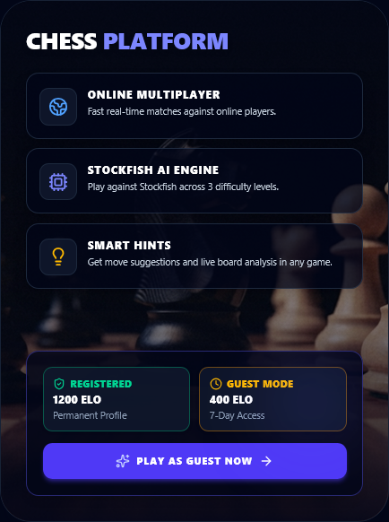
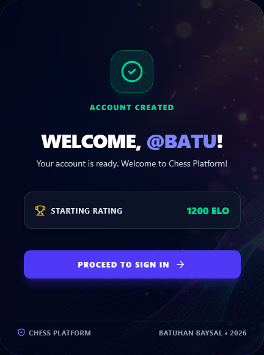
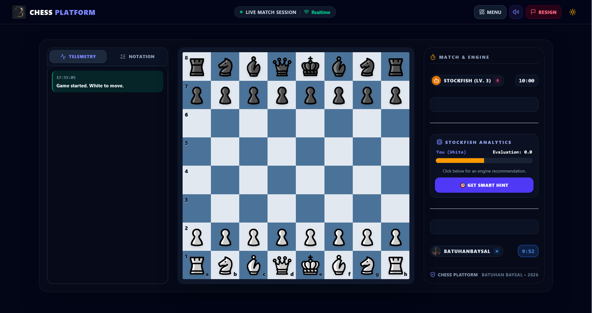
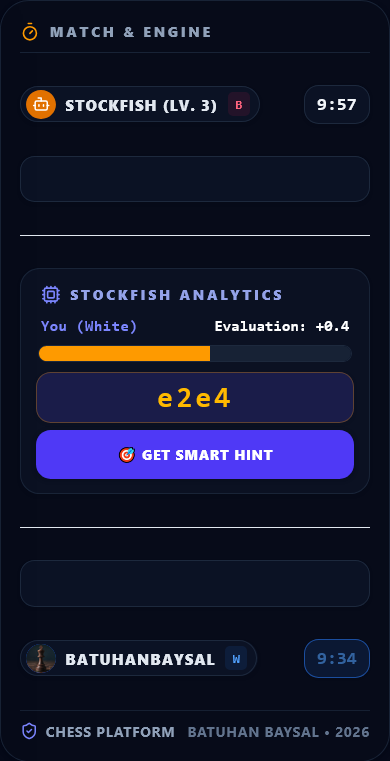
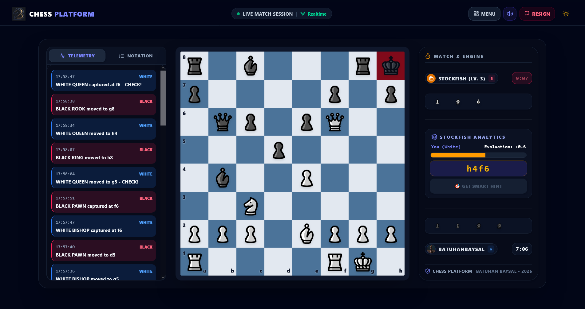
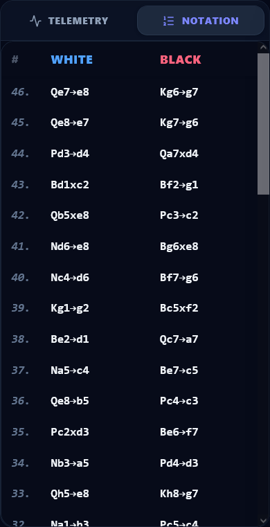
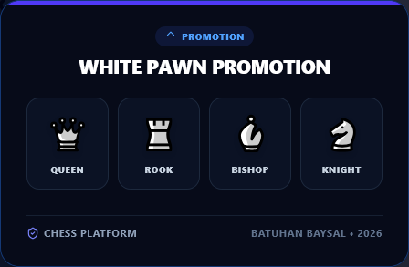
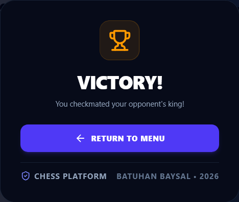

# ♟️ Chess Platform

> *A Full-Stack Chess Ecosystem Featuring Server-Authoritative Logic, AI Integration, Asynchronous Eventing, and Hybrid Cloud Production Deployment.*


[](https://chess-platform-app.vercel.app)


> **Try it:** open the [live demo](https://chess-platform-app.vercel.app) → **Play as Guest** → **Play vs Computer**. No sign-up needed.

**Chess Platform** is a full-stack, real-time multiplayer chess ecosystem built with clean architecture and strict server-authoritative state management, deployed live on Oracle Cloud and Vercel. All game rules, timers, and state transitions execute entirely on the server to prevent client-side manipulation, synchronized via a low-latency, throttled WebSocket pipeline.

<p align="center">
  
  <br>
  <em>Dual-client real-time multiplayer match: Low-latency STOMP synchronization, server-authoritative move validation, and checkmate detection.</em>
</p>

<details>
  <summary><span style="font-size: 1.15em; font-weight: bold;">🎬 Additional Feature Demos (AI Practice & Authentication)</span></summary>
  <br>

  <table width="100%">
    <tr>
      <th width="50%" align="center">
        Stockfish AI Engine & Smart Telemetry<br>
        <sub>Real-time evaluation bar, win-probability metrics, and on-demand move hints.</sub>
      </th>
      <th width="50%" align="center">
        Identity, Authentication & Navigation<br>
        <sub>Keycloak-backed Sign Up / Sign In, guest access, and responsive player menu.</sub>
      </th>
    </tr>
    <tr>
      <td width="50%" align="center" valign="top">
        
      </td>
      <td width="50%" align="center" valign="top">
        
      </td>
    </tr>
  </table>
</details>

---

## 💡 What I Built & Key Engineering Focus

* **Custom Pure-Java Rule Engine:** Instead of using third-party chess libraries, I designed and implemented the full FIDE rule set (piece geometry, check/checkmate, castling, en passant, pawn promotion, draw conditions) natively in pure Java.
* **Server-Authoritative Real-Time Sync:** Game state, move verification, and match clocks run strictly on the backend to prevent client-side manipulation, synchronized across players via WebSocket (STOMP) with Redisson distributed locks.
* **Asynchronous AI Telemetry:** I integrated the Stockfish UCI engine as a native sub-process, decoupling heavy post-match deep analysis to background RabbitMQ queues so active gameplay WebSockets remain responsive.
* **Full-Stack Observability & Quality:** Implemented distributed tracing with OpenTelemetry, metric monitoring via Prometheus and Grafana, and established comprehensive multi-tier test suites that pass the SonarQube Quality Gate.

---

## 🛠️ Technology Stack

* **Backend:** Java 17 • Spring Boot 3.4 • Spring Security 6 • OAuth2 (Keycloak) • WebSocket (STOMP) • Spring Data JPA • Liquibase • MapStruct • Lombok • SpringDoc OpenAPI • AWS SDK v2 • Resilience4j • Redisson • Stockfish UCI Engine • Testcontainers
* **Frontend:** React 19 • TypeScript 5.9 • Vite 8 • Vitest • React Testing Library • Playwright • Tailwind CSS v4 • React Router v6 • Axios • SockJS / STOMP • Recharts • DnD Kit • Lucide React
* **Infrastructure & Data:** PostgreSQL 15 • Redis 7 • RabbitMQ • MinIO • Docker Compose • Oracle Cloud Infrastructure (OCI) • Vercel
* **Observability & Quality:** Prometheus • Grafana • Loki • Tempo • Promtail • OpenTelemetry • JaCoCo • SonarQube

---

## 🎮 Functional Overview & User Experience

This platform provides a complete web chess experience powered by a custom-built in-house chess engine, paired with dedicated user tiers, low-latency multiplayer rooms, Stockfish AI telemetry, and comprehensive post-match analytics.

### 👤 Identity, Roles & Account Governance
* **Multi-Tier User Access:**
    * **Administrator (`ADMIN`):** Full data governance with controls to audit active sessions, inspect user tables, filter accounts, and simulate test matches.
    * **Registered Player (`USER`):** Baseline onboarding at **1200 ELO** with self-service account settings to update usernames, email addresses, passwords, or permanently delete the account.
    * **Guest Player (`GUEST`):** Instant, credential-free entry with a starting rating of **400 ELO** and an automatic **7-day account lifecycle**.

### ♟️ In-House Engine & Match Modes
* **Custom Pure-Java Rule Engine:**
    * All core chess mechanics—FIDE piece geometry, two-step pawn advancement, En Passant captures, Castling, Pawn Promotion modals, Check/Checkmate, Stalemate, and insufficient material draws—are calculated natively by our backend engine without third-party rule packages.
* **Stockfish AI Telemetry & Smart Assist:**
    * Cross-platform IPC sub-process engine with native binary extraction for Windows and Linux (x86_64 / ARM64).
    * Integrated to provide live telemetry across **both Online Multiplayer and AI Practice matches**, including real-time dynamic evaluation bars (centipawn win-probability telemetry with 250ms caching) and on-demand move suggestions (`Get Smart Hint`).
    * Decouples heavy post-match deep analysis asynchronously via **RabbitMQ** event queues, preserving low WebSocket latency for active games.
    * Serves as an interactive sparring engine with configurable bot difficulty levels (**Level 1, 3, and 5**) and custom side selection (**White or Black**).
* **Online Multiplayer (PvP):**
    * **Real-Time Room Lifecycle:** Room creators are assigned White pieces. Open rooms are instantly broadcast to the active channels list; the moment an opponent joins or the host cancels matchmaking, the room is evicted immediately across all connected clients via WebSocket to prevent stale joins.
    * Full in-game engine assistance enabled, alongside flexible match time limits (**3, 10, or 30 minutes**) and selectable board visual themes (**Classic, Modern, Emerald**).

### 🛡️ Live Match Operations & Safety Controls
* **Interactive Promotion & Move HUD:**
    * Dedicated modal dialogs for pawn promotion selection (Queen, Rook, Bishop, Knight) for both sides.
    * Dual-mode left telemetry drawer displaying real-time text event logs and standard algebraic PGN notations.
* **Resignation Safeguards:** Two-step forfeit confirmation to avoid accidental resignations during fast play.
* **Session Recovery & Disconnect Watchdog:** Players who navigate to the menu during an active match are prompted to reconnect immediately. If an absent player fails to return before the 60-second watchdog expires, the match is forfeited as an abandonment.

### 📊 Player Dashboards, Rankings & PGN Replays
* **Performance Dashboard:** Visual progress tracking showcasing ELO ratings, total win/loss/draw records, and circular match distribution charts.
* **Decoupled Match Histories:** Dedicated server-paginated views separating **Ranked (PvP)** and **AI Practice** match records.
* **Interactive PGN Match Replay:** Step-by-step game analyzer featuring forward/backward move stepping, perspective flipping, board inversion, and single-click PGN exports.
* **Leaderboards:** Top-3 podium showcase on the main landing dashboard with dedicated global rankings accessible via a unified modal.

<details>
  <summary><span style="font-size: 1.15em; font-weight: bold;">📸 Platform Feature Showcase (Click to expand)</span></summary>
  <br>

  <table width="100%">
    <tr>
      <th width="50%" align="center">Instant Guest Onboarding<br><sub>Frictionless entry with 400 baseline ELO and 7-day TTL lifecycle.</sub></th>
      <th width="50%" align="center">Secure Account Creation<br><sub>Keycloak-backed registration establishing a 1200 baseline rating.</sub></th>
    </tr>
    <tr>
      <td width="50%" align="center" valign="top">
        
      </td>
      <td width="50%" align="center" valign="top">
        
      </td>
    </tr>
    <tr>
      <th width="50%" align="center">Server-Authoritative Match Board<br><sub>Real-time game state, synchronized clocks, and active turn highlights.</sub></th>
      <th width="50%" align="center">Stockfish AI Telemetry & Smart Hints<br><sub>Dynamic evaluation bar and on-demand tactical move suggestions.</sub></th>
    </tr>
    <tr>
      <td width="50%" align="center" valign="top">
        
      </td>
      <td width="50%" align="center" valign="top">
        
      </td>
    </tr>
    <tr>
      <th width="50%" align="center">Live Mid-Game Battle & Check Telemetry<br><sub>Piece capture counters, red threat alerts, and live event audit feed.</sub></th>
      <th width="50%" align="center">PGN Move Notation Stepper<br><sub>Server-validated algebraic notation tracking every half-move chronologically.</sub></th>
    </tr>
    <tr>
      <td width="50%" align="center" valign="top">
        
      </td>
      <td width="50%" align="center" valign="top">
        
      </td>
    </tr>
    <tr>
      <th width="50%" align="center">Interactive Pawn Promotion (Pure Java)<br><sub>Modal selection transforming pawns to Queen, Rook, Bishop, or Knight.</sub></th>
      <th width="50%" align="center">Match End Adjudication<br><sub>Immediate win/loss modals for checkmate, abandonment, or draw.</sub></th>
    </tr>
    <tr>
      <td width="50%" align="center" valign="top">
        
      </td>
      <td width="50%" align="center" valign="top">
        
      </td>
    </tr>
  </table>
</details>

---

## 🏗️ Engineering Highlights

* **🧩 Hexagonal Architecture (Ports & Adapters):** Strict boundary isolation between core domain invariants, application use cases, and infrastructure adapters (Spring Boot, Keycloak, S3, PostgreSQL, RabbitMQ).
* **🧠 Resilient UCI Engine Integration:** Thread-safe Stockfish sub-process IPC management utilizing `ReentrantLock`, cross-platform binary auto-extraction, process crash restart routines, and in-memory centipawn evaluation caching (`250ms`).
* **⚡ Resilient Concurrency & Distributed Locks:** Server-authoritative state machine with per-game distributed locks (**Redisson `RLock`**) to eliminate race conditions, real-time STOMP lobby eviction on room occupancy/cancellation, and deterministic watchdog routines for disconnected sessions.
* **🔄 Full-Stack Observability & Tracing:** Distributed tracing via **OpenTelemetry Java Agent**, metric scraping via Prometheus, and structured logging unified across the **LGTM stack** (Loki, Grafana, Tempo, Prometheus).
* **🖥️ Feature-Sliced React 19 Frontend:** High-frequency rendering synchronized via `requestAnimationFrame`, zero-asset sound synthesis using the browser's native **Web Audio API**, and drag-and-drop mechanics.
* **🏆 Strict Quality Benchmarks:** Tested through a multi-tier testing pyramid (Vitest, React Testing Library, Playwright, and Testcontainers PostgreSQL) passing the **SonarQube Quality Gate with Rating A**.

---

## 🏛️ Project Ecosystem & Architecture Guides

| Document / Guide | Purpose & Direct Link |
| :--- | :--- |
| **⚙️ Backend Engine** | Java 17 core domain, Spring Boot 3 REST/WebSocket APIs, and Redis locks.<br>👉 [**Backend README (`chess-backend`)**](chess-backend/README.md) |
| **🎨 Frontend UI** | React 19 client, Web Audio API sound engine, and interactive PGN stepper.<br>👉 [**Frontend README (`chess-frontend`)**](chess-frontend/README.md) |
| **🧪 Testing Strategy** | Unit, integration slice tests, Playwright specs, and coverage gates.<br>👉 [**Testing Guide (`docs/TESTING.md`)**](docs/TESTING.md) |
| **🏗️ Architecture Blueprint** | Hexagonal architecture, ports/adapters, and full-stack topology.<br>👉 [**Architecture Guide (`docs/ARCHITECTURE.md`)**](docs/ARCHITECTURE.md) |
| **🧠 Engineering Decisions** | Architectural Decision Records (ADRs), concurrency controls, and design tradeoffs.<br>👉 [**Engineering Decisions (`docs/ENGINEERING_DECISIONS.md`)**](docs/ENGINEERING_DECISIONS.md) |
| **📊 Infrastructure & LGTM** | Container profiles, LGTM observability pipelines, and OCI deployment.<br>👉 [**Infrastructure Report (`docs/INFRASTRUCTURE.md`)**](docs/INFRASTRUCTURE.md) |
| **🚀 Developer Setup** | Local prerequisites, profile configurations, and debugging workflows.<br>👉 [**Development Guide (`docs/DEVELOPMENT.md`)**](docs/DEVELOPMENT.md) |
| **📜 Changelog** | Complete release notes, milestones, and version history.<br>👉 [**Changelog (`docs/CHANGELOG.md`)**](docs/CHANGELOG.md) |

---

## 🐳 Infrastructure & Quality Assurance

The application ecosystem is containerized via **Docker Compose** across dedicated execution profiles, continuously monitored and verified against enterprise quality gates.

<details>
  <summary><span style="font-size: 1.15em; font-weight: bold;">📸 SonarQube Consolidated Quality Gate Report</span></summary>
  <br>
  <p align="center">
    
    <br>
    <em>SonarQube Quality Gate Passed: 570 Backend Tests (81.9% Coverage) & 350 Frontend Tests (85.5% Coverage) & 108 Playwright E2E Tests with 0 Open Bugs or Vulnerabilities</em>
  </p>
</details>

---

## 🚀 Quick Start

### 1. Clone & Git LFS
Stockfish binaries are tracked via Git LFS. Ensure LFS is initialized before pulling:
```bash
git lfs install
git clone [https://github.com/BatuhanBaysal/chess-platform.git](https://github.com/BatuhanBaysal/chess-platform.git)
cd chess-platform
git lfs pull
cp .env.example .env
```

### 2. Start Dependent Backing Services
To run and debug the project locally in your IDE, boot the core backing infrastructure:
```bash
docker compose up -d db redis rabbitmq keycloak
```

> [!WARNING]
> **Local Runtime Dependency:** The Spring Boot backend (`chess-server`) requires running `db` (PostgreSQL) and `redis` containers to start properly. Launching the backend in your IDE without these services running will trigger connection refusal errors in the terminal (`localhost:5432` / `localhost:6379`). Additionally, backend integration test suites leverage Testcontainers; ensure the local Docker daemon is active to prevent test execution failures.

### 3. Run Applications Locally
* **Backend (`chess-backend`):**
  ```bash
  cd chess-backend
  ./mvnw spring-boot:run -Dspring-boot.run.profiles=local
  ```
  The REST and WebSocket API endpoints will be available at `http://localhost:8080` (Swagger UI: `http://localhost:8080/swagger-ui.html`).

* **Frontend (`chess-frontend`):**
  ```bash
  cd chess-frontend
  npm install
  npm run dev
  ```
  The client application will be accessible at `http://localhost:5173`.

> For full container orchestration (`docker compose --profile core up`), production cloud deployments (OCI, Vercel), and LGTM monitoring provisioning, refer to the [**Developer Onboarding Guide (`docs/DEVELOPMENT.md`)**](docs/DEVELOPMENT.md).

---

## 💡 Behind the Code: My Journey with This Project

> *"This platform is the culmination of a continuous learning curve that started during my internship at Chippin (part of Koç Group) in the summer of 2024, where I first worked with Java, Spring Boot, React, and PostgreSQL."*

While I had prior experience working with these foundational technologies on individual features, **Chess Platform** marks several pivotal technical firsts in my software engineering journey:

* **First End-to-End Production Deployment:** While earlier projects remained in local or controlled development environments, this platform represents the first full-stack architecture I took entirely to production — deploying the backend on containerized **Oracle Cloud Infrastructure (OCI ARM)** with dynamic DNS, and serving the frontend globally via **Vercel Edge**.
* **Strict Project Governance from Day One:** Rather than treating it as a casual repository, I implemented an enterprise-grade Agile workflow on GitHub for the first time. Every enhancement followed a strict lifecycle: **Milestone ➔ Issue ➔ Feature Branch ➔ PR (with CI checks) ➔ Release Tag (Semantic Versioning)**, tracked continuously via GitHub Projects.
* **First Comprehensive Frontend Testing Suite:** Prior to this project, my test discipline was concentrated heavily on the backend. Here, I designed and implemented a full frontend testing pyramid from scratch for the first time — writing isolated component/hook suites with **Vitest & React Testing Library** and automating cross-browser end-to-end user journeys using **Playwright**.
* **Architectural Evolution & Rework:** The authentication layer began as a custom, hand-rolled JJWT implementation. As the domain grew, I recognized the architectural overhead of managing token lifecycles and blacklists manually, leading to a complete rewrite into an enterprise-grade **Keycloak OAuth2/OIDC Resource Server**.

---

## 👨‍💻 Author
**Batuhan Baysal** — *Junior Software Engineer*

[](https://linkedin.com/in/batuhan-baysal)
[](https://github.com/BatuhanBaysal)
