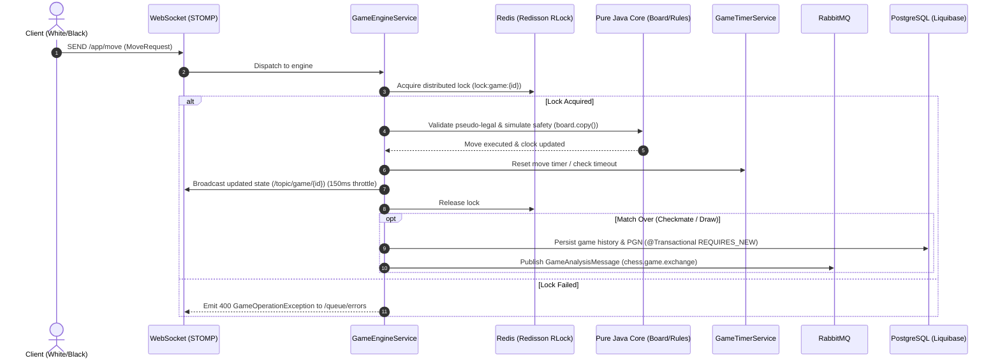
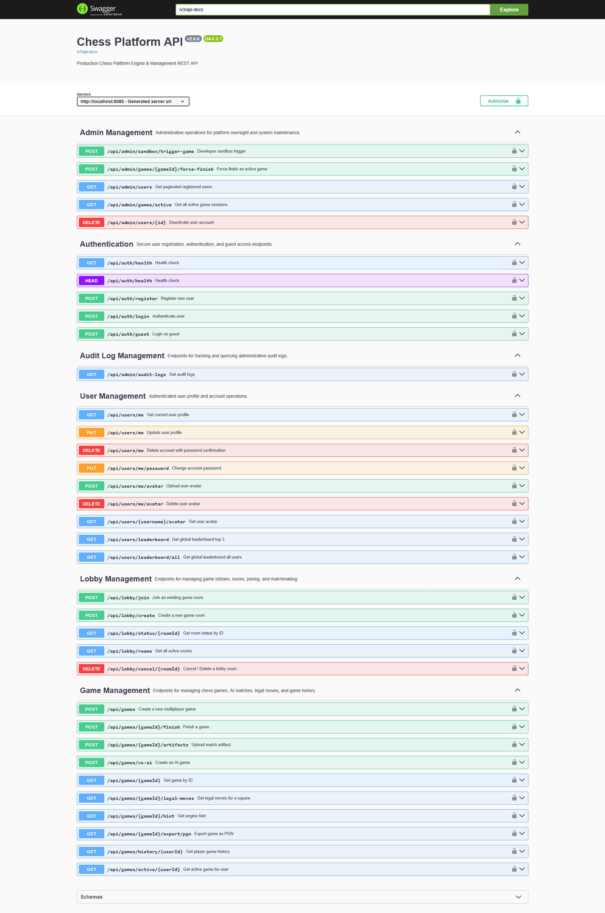

# ♟️ Chess Platform — Backend Engine & API


The core backend service for the Chess Platform, engineered around Hexagonal Architecture (Ports and Adapters) principles. It acts as the server-side Single Source of Truth (SSOT), providing an authoritative framework-agnostic FIDE chess engine, real-time STOMP messaging, distributed concurrency controls, and event-driven post-match analysis.

---

## 🏗️ Architecture & Core Engineering Decisions

### 1. Authoritative Chess Engine (Pure Java & Zero Dependencies)
* **Type-Safe Domain Modeling:** Piece hierarchies are bounded using Java 17 `sealed abstract class Piece permits Pawn, Knight, Bishop, Rook, Queen, King` to eliminate invalid types at compile-time, while board coordinates are modeled as immutable `Position` records with boundary validation.
* **Simulation-Based Move Safety:** Moves undergo a two-phase check: first validating pseudo-legal trajectories, followed by isolated board simulations (`Board.copy()`) to prevent discovered checks and pinned piece violations (`isMoveSafe`).
* **Complete Rule Engine:** Native support for Castling (verifying non-moved pieces and safe trajectory squares), En Passant, Pawn Promotion, Checkmate/Stalemate detection, Threefold Repetition, the 50-Move Rule, and Insufficient Material draws.

### 2. Concurrency & Real-Time Flow
* **Distributed Locking (Redisson RLock):** Simultaneous move executions (`lock:game:{gameId}`) and lobby joins (`lock:lobby:{roomId}`) use programmatic Redis locks to eliminate race conditions across clustered instances.
* **Clocks & Watchdog Management:** Blitz/Rapid timers are synchronized down to the millisecond using dedicated scheduler routines, while a heartbeat watchdog terminates abandoned matches after 60 seconds of client disconnection.
* **Traffic Throttling:** Rapid game updates and clock ticks are regulated via a 150ms throttle buffer (`GameBroadcastManager`) before publishing to WebSocket STOMP subscribers.

### 3. Event-Driven Messaging & AI Opponent
* **Cross-Platform Stockfish Engine:** Dynamically extracts and runs the appropriate OS binary (Windows `.exe`, Linux x86_64, or Linux ARM64) as an isolated sub-process via `ProcessBuilder`, communicating asynchronously through the UCI protocol with self-healing process recovery.
* **Asynchronous Match Analysis (RabbitMQ):** Upon match completion, a `GameAnalysisMessage` is dispatched to `chess.game.exchange` via `GameEventProducer`, allowing decoupled workers to execute Stockfish depth-12 evaluations without blocking HTTP/WS request threads.

### 4. Security, Persistence & Storage
* **Stateless OAuth2 / Keycloak IAM:** Configured as a Stateless Resource Server verifying Keycloak JWTs. Dynamic role mappings via `KeycloakRoleConverter` feed into a transitive `RoleHierarchy` (`ROLE_ADMIN > ROLE_USER > ROLE_GUEST`).
* **AOP-Driven Audit Logging:** Admin operations are captured transparently using custom `@AuditableAction` annotations and an Aspect (`AuditLogAspect`), decoupling business code from audit persistence.
* **Hexagonal Storage Port:** User avatars and match PGN artifacts are managed through `FileStoragePort`, implemented by `S3StorageAdapter` with AWS SDK v2, providing interchangeable support for AWS S3, OCI Object Storage, and local MinIO.
* **Database Versioning & Optimization:** PostgreSQL schemas are managed via sequential Liquibase changesets. JPA entities enforce `FetchType.LAZY` with targeted `@EntityGraph` definitions to eliminate N+1 queries during match retrieval.

---

## 🔄 Real-Time Move Lifecycle



---

## ⚖️ Key Architectural Trade-offs

* **In-Memory Active Sessions vs. Distributed Cache:** Active game boards and clocks reside in memory (`ConcurrentHashMap`) protected by Redis distributed locks instead of serializing entire board objects to Redis on every sub-second tick. *Trade-off:* Drastically reduced serialization latency and zero GC pressure for 100ms clock ticks, with disconnect recovery managed by the 60-second watchdog.
* **Deep-Copy Move Simulation vs. Move Reversal:** Implemented `board.copy()` for check validation rather than executing moves and rolling them back on the live board. *Trade-off:* Marginally higher short-lived object allocations in exchange for zero state corruption risk across concurrent move queries.
* **Asynchronous Stockfish IPC over JNI/Native Binding:** Used CLI `ProcessBuilder` IPC instead of native C++ bindings via JNI. *Trade-off:* Prevents JVM crashes if the native chess motor encounters an unhandled fault; isolated sub-processes can be terminated and self-healed independently.

---

## 🔌 Protocol & Communication Contract

| Endpoint / Channel | Specifications & Purpose |
| :--- | :--- |
| **`/ws-chess`** | `STOMP (SockJS)` • **Public / JWT**<br>WebSocket handshake and transport negotiation endpoint. |
| **`/topic/game/{gameId}`** | `STOMP Subscribe` • **User / Guest**<br>Real-time board state, millisecond clocks, and match outcome events. |
| **`/topic/lobby/{roomId}`** | `STOMP Subscribe` • **User / Guest**<br>Matchmaking room synchronization and player pairing broadcasts. |
| **`/app/move`** | `STOMP Send` • **Authenticated**<br>Dispatches validated chess coordinates (`MoveRequest`). |
| **`POST /api/lobby/create`** | `REST HTTP` • **User / Guest**<br>Spawns matchmaking room (Rate-limited: 2 requests/min). |
| **`POST /api/games/vs-ai`** | `REST HTTP` • **Authenticated**<br>Initializes Stockfish AI match with difficulty and clock settings. |
| **`GET /api/games/{id}/export/pgn`** | `REST HTTP` • **Authenticated**<br>Streams match PGN export generated dynamically or fetched from S3. |
| **`GET /actuator/prometheus`** | `REST HTTP` • **Internal / Admin**<br>Exposes Prometheus runtime metrics and Micrometer gauges. |

<details>
  <summary><b>📸 Preview: Swagger UI (OpenAPI 3.1 Specification)</b></summary>
  <br>
  <p align="center">
      
    </p>
</details>

<details>
  <summary><b>📦 Preview: Real-Time STOMP Move Payload & Broadcast Event</b></summary>
  <br>

**Client Send (`/app/move`):**
  ```json
  {
    "gameId": "game-123",
    "fromFile": 4,
    "fromRank": 1,
    "toFile": 4,
    "toRank": 3,
    "promotionPiece": null
}
  ```

**Server Broadcast (`/topic/game/game-123`):**
  ```json
  {
    "gameId": "game-123",
    "boardRepresentation": "rnbqkbnr/pppp1ppp/8/4p3/4P3/8/PPPP1PPP/RNBQKBNR",
    "currentTurn": "BLACK",
    "status": "ACTIVE",
    "whiteRemainingTimeMs": 298450,
    "blackRemainingTimeMs": 300000,
    "lastMoveMessage": "Pe2→e4"
  }
  ```
</details>

---

## 🛠️ Technology Stack

| Ecosystem / Layer | Technologies & Purpose |
| :--- | :--- |
| **Core & Web Runtime** | **Java 17, Spring Boot 3.4.6, Spring WebSocket (STOMP/SockJS)**<br>Type-safe server-side core and bidirectional real-time communication. |
| **Data & Migrations** | **PostgreSQL, Spring Data JPA (`@EntityGraph`), Liquibase**<br>Relational persistence, query optimization (no N+1), and schema migrations. |
| **Distributed Systems** | **Redis, Redisson (Distributed `RLock`), Spring Cache**<br>Cross-node mutual exclusion and sub-millisecond query caching. |
| **Messaging & Queues** | **RabbitMQ (TopicExchange, Jackson2JsonMessageConverter)**<br>Decoupled, asynchronous match evaluation and event distribution. |
| **Identity & Security** | **Spring Security 6 (OAuth2 Resource Server), Keycloak Admin Client**<br>Centralized JWT token validation, transitive RBAC, and guest accounts. |
| **Fault Tolerance** | **Resilience4j (Circuit Breaker, Rate Limiter)**<br>Brute-force protection, concurrency limits, and engine fault isolation. |
| **Chess Engine & AI** | **Stockfish UCI Engine via `ProcessBuilder`**<br>Cross-platform native AI evaluation and position analysis pipeline. |
| **Object Storage** | **AWS S3 Java SDK v2 (AWS S3, OCI & Local MinIO)**<br>Scalable blob storage for profile avatars and archived match artifacts. |
| **Code Generation & Docs** | **MapStruct, Lombok, Springdoc OpenAPI (Swagger UI)**<br>Compile-time bean mapping, boilerplate reduction, and API documentation. |
| **Telemetry & Metrics** | **OpenTelemetry Java Agent, Micrometer, Prometheus, Tempo**<br>JVM auto-instrumentation, OTLP distributed tracing, and metric exposition. |
| **Testing & Quality** | **JUnit 5, Mockito, AssertJ, Testcontainers (PostgreSQL), JaCoCo, SonarQube**<br>Production-identical integration tests, coverage gates, and static analysis. |

---

## 📁 Source Code Structure

```text
src/main/java/com/batuhan/chess/
├── api/                            # Inbound Adapters (External Drivers)
│   ├── config/                     # Protocol, Security, RabbitMQ, Redis, S3 configs
│   ├── controller/                 # REST Controllers & STOMP WebSocket Handlers
│   ├── dto/                        # Immutable validation-ready Java Records
│   └── exception/                  # GlobalExceptionHandler (@RestControllerAdvice & WS handler)
├── application.service/            # Use Case Orchestration & Outbound Adapters
│   ├── admin/                      # Admin workflows & audit log services
│   ├── auth/                       # Keycloak synchronization & auth coordination
│   ├── game/                       # Game session management, Stockfish IPC, timers, & distributed locks
│   ├── storage/                    # S3 / MinIO storage adapter implementing FileStoragePort
│   └── user/                       # User profile, leaderboard, & credential management
└── domain/                         # Pure Framework-Agnostic Core
    ├── model/                      # Piece hierarchy (Sealed classes), Board, Rule evaluators, & Entities
    └── repository/                 # Domain Ports (FileStoragePort) & Repository interfaces
```

---

## 🧪 Testing Strategy & Quality Standards

The backend service enforces strict **Arrange-Act-Assert (AAA)** patterns, thread-safety verifications, and real infrastructure isolation. In-memory approximations (e.g., H2) are excluded in favor of **Testcontainers (PostgreSQL 15)** to guarantee production parity across Liquibase migrations, constraints, and query execution plans.

### 📊 Quality Gate & Test Summary

* **Unit & Slice Tests:** Domain rules (FIDE chess validation, move safety, raycasting) and slice-based web controllers are verified using **JUnit 5**, **Mockito**, and **AssertJ**.
* **Integration Tests (Testcontainers):** Repositories, distributed locks (**Redisson RLock**), and messaging (**RabbitMQ**) are tested against containerized services.
* **Quality Gate (SonarQube):** Clean code and strict quality standards with **Rating A** across all health metrics.

| Metric | Target / Gate | Result | Status |
| :--------------------------------- | :------------ | :------------------------------------- | :----- |
| **Automated Tests** | 100% Pass | **570 Passed (0 Failed, 0 Skipped)** |  |
| **Code Coverage (SonarQube / JaCoCo)** | $\ge$ 80% | **81.9%** (Overall) / **80.2%** (New Code) |  |
| **Code Duplication** | $\le$ 3.0% | **0.0%** (across 6.5k lines analyzed) |  |
| **Security & Vulnerabilities** | 0 Open Issues | **0 (Rating A)** |  |
| **Reliability & Maintainability** | 0 Open Issues | **0 Bugs, 0 Code Smells (Rating A)** |  |

<details>
  <summary><b>📸 Preview: SonarQube Backend Quality Gate Report</b></summary>
  <br>
  <p align="center">
    
    <br>
    <em>SonarQube Quality Gate Passed: 81.9% Overall Coverage, 0 Bugs, 0 Vulnerabilities, 0.0% Duplication across 5.4k LOC</em>
  </p>
</details>

```bash
# Execute unit/integration suites and generate JaCoCo coverage reports:
./mvnw clean verify
```

> [!TIP]
> For the complete testing architecture, concurrency stress matrices, IPC recovery tests, and full screenshot galleries, see the [**Comprehensive Testing Guide (`docs/TESTING.md`)**](../docs/TESTING.md).

---

## 🚀 Local Setup & Development

### 1. Prerequisites & Git LFS
Stockfish engine binaries are tracked via Git LFS. Ensure Git LFS is initialized before building:
```bash
git lfs install
git clone [https://github.com/BatuhanBaysal/chess-platform.git](https://github.com/BatuhanBaysal/chess-platform.git)
cd chess-platform
git lfs pull
```

### 2. Environment Configuration (.env)
Create a `.env` file in the project root (see `.env.example` for reference):
```env
# Database Credentials (Local PostgreSQL)
CHESS_DB_URL=jdbc:postgresql://localhost:5432/chess_db
CHESS_DB_USERNAME=your_db_username
CHESS_DB_PASSWORD=your_db_password

# Cache & Distributed Locking (Local Redis)
CHESS_REDIS_HOST=localhost
CHESS_REDIS_PORT=6379

# Event-Driven Messaging (RabbitMQ)
RABBITMQ_HOST=localhost
RABBITMQ_PORT=5672

# Identity & Access Management (Keycloak)
KEYCLOAK_ISSUER_URI=http://localhost:8081/realms/chess-realm
KEYCLOAK_GUEST_CLIENT_SECRET=your_keycloak_guest_secret

# Object Storage (Local MinIO / AWS S3 / OCI)
AWS_S3_ENDPOINT=http://localhost:9000
AWS_S3_ACCESS_KEY=your_s3_access_key
AWS_S3_SECRET_KEY=your_s3_secret_key

# Default Administrator Seed Configuration
ADMIN_USERNAME=your_admin_username
ADMIN_EMAIL=your_admin_email@example.com
ADMIN_PASSWORD=your_secure_admin_password
```

### 3. Start Infrastructure Dependencies
To run the backend locally while developing in your IDE, start only the required backing services via Docker Compose:
```bash
# Starts PostgreSQL, Redis, RabbitMQ, and Keycloak in the background
docker compose up -d db redis rabbitmq keycloak
```

### 4. Run Backend Application
```bash
# Execute unit/integration tests (requires Docker daemon for Testcontainers)
./mvnw clean test

# Run the Spring Boot backend with the local profile
./mvnw spring-boot:run -Dspring-boot.run.profiles=local
```

<details>
  <summary><b>🔍 Verify Backend Health & Telemetry</b></summary>
  <br>

  ```bash
  # Check overall application and database health:
  curl -s http://localhost:8080/actuator/health | jq

  # Inspect exposed Prometheus metrics:
  curl -s http://localhost:8080/actuator/prometheus | grep chess_moves
  ```
</details>

---

## 🧭 Navigation & Related Modules

| Module / Document | Purpose & Direct Link |
| :--- | :--- |
| **Platform Root** | Global overview, docker-compose orchestration, and multi-profile guides.<br>👉 [**Root README (`README.md`)**](../README.md) |
| **Frontend Client** | React 19 UI, Web Audio API sound engine, and interactive PGN replay.<br>👉 [**Frontend Engine (`chess-frontend`)**](../chess-frontend/README.md) |
| **System Architecture** | Domain boundaries, hexagonal ports/adapters, and component topology.<br>👉 [**Architecture Guide (`docs/ARCHITECTURE.md`)**](../docs/ARCHITECTURE.md) |
| **Engineering Decisions** | Architectural Decision Records (ADRs) and technical trade-offs.<br>👉 [**Engineering Decisions (`docs/ENGINEERING_DECISIONS.md`)**](../docs/ENGINEERING_DECISIONS.md) |
| **Testing Strategy** | Test execution matrices, MockMvc layer tests, and Testcontainers.<br>👉 [**Testing Guide (`docs/TESTING.md`)**](../docs/TESTING.md) |
| **Infrastructure & Deploy** | Multi-stage Docker packaging, Keycloak realm import, and OCI storage.<br>👉 [**Infrastructure Docs (`docs/INFRASTRUCTURE.md`)**](../docs/INFRASTRUCTURE.md) |
