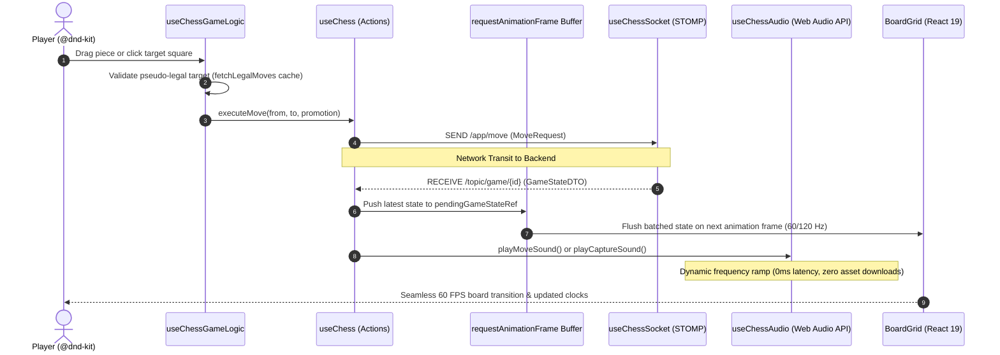

# ♟️ Chess Platform — Frontend Client & UI Engine


The reactive web client for the Chess Platform, engineered using **React 19**, **TypeScript 5.9**, **Vite 8**, and **Tailwind CSS v4**. It features a **Feature-Sliced Design (FSD)** architecture, an external asset-free **Web Audio API** sound synthesis engine, server-authoritative real-time STOMP synchronization, sub-second move throttling with `requestAnimationFrame`, and an automated multi-layer test pyramid.

---

## 🏗️ Architecture & Core Engineering Decisions

### 1. Feature-Sliced Modularity & Domain Isolation
* **Feature-Sliced Architecture (FSD):** Codebase is structured by business capability (`features/admin`, `features/auth`, `features/chess`, `features/menu`, `features/user`) rather than technical file types, eliminating circular dependencies and decoupling board mechanics from identity and administrative workflows.
* **Composite Hook Facade Pattern (`useChess`):** Rather than implementing a monolithic "God Hook", the main game loop delegates responsibilities across 4 specialized custom hooks:
    * `useChessSocket`: STOMP lifecycle, `/app/game/heartbeat` ping routines (10s intervals), and private `/user/queue/errors` handling.
    * `useChessActions`: Move dispatching, AI game initialization, Stockfish hints, and surrender commands.
    * `useChessTimer`: Millisecond-accurate turn clocks compensating for network jitter via `lastUpdateRef`.
    * `useChessGameLogic`: 64-square grid state, legal move validation targets, and session-scoped persistence (`chess_game_logs_{gameId}`).

### 2. High-Frequency Rendering & Network Throttling
* **Frame-Rate Throttling (`requestAnimationFrame`):** Rapid server broadcasts (sub-second clocks, move updates, engine centipawn scores) are aggregated into a `pendingGameStateRef` buffer and synced to the browser's refresh rate (60/120 Hz) via `requestAnimationFrame`, completely eliminating virtual DOM layout thrashing and UI freezes.
* **Component Render Boundary Optimization:** Drag-and-drop piece components are wrapped with `React.memo` to isolate coordinate updates to actively moving squares, preventing full-board (64-square) re-render cycles.

### 3. Zero-Asset Audio Engine (Web Audio API)
* **Hardware-Synthesized Sound Effects (`useChessAudio`):** Eliminates external `.mp3`/`.wav` media asset requests by synthesizing sound waves at runtime using the browser's native `AudioContext` and `OscillatorNode`:
    * *Move:* Triangle wave ramping from 320 Hz down to 80 Hz ($50\text{ ms}$).
    * *Capture:* Sine wave ramping from 450 Hz down to 110 Hz ($80\text{ ms}$).
    * *Check:* Dual-frequency chord sequence ($587.33\text{ Hz}$ and $880\text{ Hz}$).
    * *Victory / Defeat:* Major ascending arpeggio vs. low-frequency decaying sawtooth wave.
* **Cross-Tab Synchronization:** Audio toggle preferences are synchronized reactively across open browser tabs via custom `window.dispatchEvent` events and `localStorage`.

### 4. Interactive Match Replay & PGN Stepper
* **In-Memory State Simulation (`MatchReplayModal`):** Parses raw PGN algebraic strings and reconstructs move-by-move board states in memory, providing play/pause auto-replay ($850\text{ ms}$ step interval), perspective board flipping, and one-click `.pgn` file blob downloads.
* **Real-Time Engine Evaluation Bar (`EvaluationBar`):** Visualizes Centipawn (CP) and Mate-in-N scores calculated by Stockfish with dynamic smooth transitions and inaccuracy badges (`??`, `?`, `?!`).

### 5. Client Security, Token Eviction & ADR-001 Enforcement
* **Automatic Session Eviction (ADR-001):** Global Axios response interceptors listen for `ACCOUNT_DEACTIVATED` or `401 Unauthorized` payloads. Upon reception, all `localStorage` and `sessionStorage` tokens are instantly evicted, forcefully redirecting the client to `/sign-up`.
* **Type-Safe Domain Contracts:** TypeScript domain models strictly mirror backend Java records and OpenAPI contracts, preventing silent runtime serialization bugs.

---

## 🔄 Real-Time Client Move & Frame Lifecycle



---

## ⚖️ Key Architectural Trade-offs

* **HTML5 Web Audio API vs. Pre-rendered Audio Assets:** Used browser hardware oscillators instead of pre-rendered `.mp3` audio files. *Trade-off:* Requires explicit mathematical wave synthesis, but guarantees **0 ms network latency**, zero CDN asset requests, and is immune to 404/CORS media download failures.
* **`requestAnimationFrame` Buffering vs. Direct React State Dispatch:** Incoming WebSocket messages are queued in a reference buffer rather than triggering immediate `useState` setters. *Trade-off:* Slight internal buffering logic complexity in exchange for preventing DOM freezes during simultaneous sub-second clock ticks and rapid bullet chess moves.
* **Server-Authoritative State vs. Client-Side Move Prediction:** The client does not definitively mutate the board locally; it awaits the authenticated STOMP broadcast from the backend. *Trade-off:* Network latency is noticeable on poor connections, but completely prevents board state desynchronization, illegal pawn promotions, and race condition exploits.

---

## 🔌 Communication & API Gateway

| Channel / Route | Protocol / Target | Specifications & Security |
| :--- | :--- | :--- |
| **`/ws-chess`** | `WebSocket / SockJS` | STOMP transport handshake with fallback polyfill (`global = window`). |
| **`/topic/game/{gameId}`** | `STOMP Subscription` | Sub-second board states, millisecond timers, and game-over events. |
| **`/app/move`** | `STOMP Publication` | Dispatches validated coordinates and promotion pieces. |
| **`/api/auth/**`** | `REST API (Axios)` | Keycloak user login, registration, and anonymous guest sessions. |
| **`/api/games/**`** | `REST API (Axios)` | AI match creation, legal moves calculation, and PGN export streaming. |
| **`/api/users/me/avatar`** | `REST API (Multipart)` | S3-backed avatar uploads with cache-busting timestamping (`?t=`). |
| **`/api/admin/**`** | `REST API (Axios)` | Administrative governance, audit log queries, and active match termination. |

---

## 🛠️ Technology Stack

| Layer | Tools & Libraries | Architectural Purpose |
| :--- | :--- | :--- |
| **Core Framework** | **React 19, TypeScript 5.9, Vite 8** | Concurrent rendering, strict compile-time types, ultra-fast HMR bundling. |
| **Styling & Theme** | **Tailwind CSS v4, PostCSS, Lucide React** | High-performance CSS engine, class-based dark/light dynamic theme switching. |
| **Networking & Sockets** | **Axios, @stomp/stompjs, SockJS-Client** | REST client with 401 token eviction interceptor, reliable STOMP WebSocket duplex. |
| **Interactivity & Board** | **@dnd-kit/core, @dnd-kit/utilities** | Fluid, accessible drag-and-drop piece movements with pointer/keyboard sensors. |
| **Audio Synthesis** | **HTML5 Web Audio API (Native Browser API)** | Dynamic hardware oscillator sound synthesis (0 ms file loading delay). |
| **Visualizations** | **Recharts** | Interactive ELO distribution, rating curves, and performance analytics charts. |
| **Routing & Routing Guards**| **React Router v6** | Client-side routing with `ProtectedRoute` RBAC guards and SPA rewrite fallback. |
| **Testing Suite** | **Vitest, Testing Library, Playwright, jsdom** | Fast unit/component testing with `forks` pool isolation and cross-browser E2E. |
| **DevOps & Containers** | **Docker, Nginx Alpine, Vercel** | Multi-stage production containerization and edge hosting configurations. |

---

## 📁 Source Code Directory Hierarchy

```text
chess-frontend/
├── e2e/                        # Playwright end-to-end multi-browser test specs
├── public/                     # Static assets, brand SVGs
├── src/                        # Feature-Sliced Design core application source
│   ├── api/                    # Centralized Axios client & domain REST services
│   ├── components/             # Reusable design system atoms, molecules & chart widgets
│   ├── constants/              # Board themes, audio configs, and game constants
│   ├── features/               # Feature-sliced domain modules (admin, auth, chess, menu, user)
│   ├── hooks/                  # Global lifecycle, theme & orchestration hooks
│   ├── routes/                 # Central routing configuration with RBAC route protection
│   ├── test/                   # Vitest setup, custom matchers, and DOM mocks
│   ├── types/                  # Strict TypeScript domain interfaces mirroring backend DTOs
│   └── utils/                  # Avatar CDN resolution and image cache-busting helpers
├── Dockerfile                  # Multi-stage production container configuration
└── nginx.conf                  # SPA routing fallback and compression server config
```

---

## 🧪 Testing Strategy & Quality Assurance

The frontend client enforces a multi-tier testing strategy combining fast in-memory component/hook execution via **Vitest** and comprehensive browser automation via **Playwright**. All code passes strict **SonarQube Quality Gate** standards with **Rating A** across all maintainability and security metrics.

### 📊 Quality Gate & Test Summary

* **Unit & Component Tests (Vitest & RTL):** 350 tests across 54 test suites verifying custom hooks (`useChessAudio`, `useChessTimer`), modal focus traps, and `@dnd-kit` board interactions with isolated process pools.
* **End-to-End Automation (Playwright):** 108 tests across 10 test suites running against Chromium, Firefox, and WebKit to validate onboarding, guest access, live piece moves, and responsive viewports.
* **Quality Gate (SonarQube):** 0 Bugs, 0 Vulnerabilities, 0 Code Smells, and strict coverage baselines.

| Metric | Target / Gate | Result | Status |
| :--------------------------------- | :------------ | :------------------------------------- | :----- |
| **Unit & Component Tests** | 100% Pass | **350 Passed (54 Suites)** |  |
| **End-to-End (E2E) Tests** | 100% Pass | **108 Passed (10 Suites)** |  |
| **Code Coverage (SonarQube / V8)** | $\ge$ 80% | **85.5%** (Overall) / **80.7%** (New Code) |  |
| **Code Duplication** | $\le$ 3.0% | **1.91%** (New Code) / 3.8% (Overall) |  |
| **Security & Vulnerabilities** | 0 Open Issues | **0 (Rating A)** |  |
| **Reliability & Maintainability** | 0 Open Issues | **0 Bugs, 0 Code Smells (Rating A)** |  |

<details>
  <summary><b>📸 Preview: SonarQube Frontend Quality Gate Report</b></summary>
  <br>
  <p align="center">
    
    <br>
    <em>SonarQube Quality Gate Passed: 85.5% Overall Coverage, 0 Bugs, 0 Vulnerabilities, 1.91% New Code Duplication across 11k LOC</em>
  </p>
</details>

```bash
# Run Vitest unit & component test suite
npm run test

# Run tests with V8 coverage matrix generation
npx vitest run --coverage --no-cache

# Execute Playwright cross-browser E2E suite (Chromium, Firefox, WebKit)
npx playwright test
```

> [!TIP]
> For the complete testing architecture, custom hook verification flows, mobile responsiveness validations, and full screenshot galleries, see the [**Comprehensive Testing Guide (`docs/TESTING.md`)**](../docs/TESTING.md).

---

## 🚀 Local Setup & Development

### 1. Prerequisites
- **Node.js:** `v20.x` or higher
- **Package Manager:** `npm` (v10+)
- **Backend Service:** Running instance on `http://localhost:8080` (or running via Docker Compose)

### 2. Environment Configuration
Create a `.env` file in the `chess-frontend/` directory (see root `.env.example` for reference):
```env
# Backend API Base URL
VITE_API_URL=http://localhost:8080

# Show LGTM Monitoring links in navigation (optional)
VITE_SHOW_MONITORING=true
```

### 3. Installation & Run
```bash
# Navigate to the frontend directory
cd chess-frontend

# Clean install dependencies
npm ci

# Start the Vite development server with HMR
npm run dev
```
The application will be accessible at `http://localhost:5173`.

---

## 🐳 Containerization & Production Deployment

The frontend utilizes a multi-stage Dockerfile designed for minimal production image footprint and zero Node.js runtime overhead:

1. **Build Stage (`node:20-alpine`):** Compiles TypeScript modules and bundles static HTML, CSS, and JS assets via Vite.
2. **Runtime Stage (`nginx:stable-alpine`):** Serves optimized static assets using lightweight Nginx with gzip compression, security headers, and an internal `try_files $uri $uri/ /index.html =404;` directive to support client-side Single Page Application (SPA) routing.

```bash
# Build the production Docker image
docker build -t chess-ui ./chess-frontend

# Run container locally on port 8082
docker run -d -p 8082:80 --name chess-ui chess-ui
```

---

## 🧭 Navigation & Related Modules

| Module / Document | Purpose & Direct Link |
| :--- | :--- |
| **Platform Root** | Global monorepo architecture, Docker Compose orchestration, and profiles.<br>👉 [**Root README (`README.md`)**](../README.md) |
| **Backend Engine** | Java 17 core engine, Spring Boot 3 API, Redis distributed locks, and RabbitMQ.<br>👉 [**Backend README (`chess-backend`)**](../chess-backend/README.md) |
| **System Architecture** | Domain boundaries, hexagonal ports/adapters, and full-stack topology.<br>👉 [**Architecture Guide (`docs/ARCHITECTURE.md`)**](../docs/ARCHITECTURE.md) |
| **Engineering Decisions** | Architectural Decision Records (ADRs) and technical trade-offs.<br>👉 [**Engineering Decisions (`docs/ENGINEERING_DECISIONS.md`)**](../docs/ENGINEERING_DECISIONS.md) |
| **Testing Strategy** | Comprehensive testing guide, Vitest configurations, and Playwright suites.<br>👉 [**Testing Guide (`docs/TESTING.md`)**](../docs/TESTING.md) |
| **Infrastructure & Deploy** | Multi-stage Docker packaging, LGTM observability stack, and OCI deployment.<br>👉 [**Infrastructure Docs (`docs/INFRASTRUCTURE.md`)**](../docs/INFRASTRUCTURE.md) |
