# 🏗️ Infrastructure & Quality Assurance Report

This document details the architectural foundation, monitoring stack, containerized deployments, and code quality standards of the **Chess Platform**, integrating configuration assets (`deploy/monitoring/`, `docker-compose.yml`) and production-grade verification proofs.

---

## 1. Containerization & Database Setup
> **Goal:** Establish a resilient, zero-configuration runtime environment using Docker Compose and automated schema migrations.

### 🐳 Docker Orchestration & Profiles
The application ecosystem is orchestrated via Docker Compose, segmented into isolated execution profiles to balance resource allocation between local development and cloud production:
* **`core` Profile:** Coordinates foundational backend services—Spring Boot application (`chess-server`), PostgreSQL database (`chess-postgres`), Redis cache (`chess-redis`), RabbitMQ broker (`chess-rabbitmq`), and Keycloak IAM (`chess-keycloak`).
* **`storage-local` Profile:** Runs local S3-compatible MinIO object storage (`chess-minio`) for avatar and artifact persistence.
* **`monitoring` Profile:** Deploys the LGTM observability pipeline (Prometheus, Grafana, Loki, Tempo, Promtail).
* **`quality` Profile:** Runs localized SonarQube code quality inspection.

* **Deterministic Dependency Health:** Strict startup ordering guarantees that `chess-server` boots only when PostgreSQL, Redis, RabbitMQ, and Keycloak report healthy statuses, eliminating race conditions during cold boots.

  
<b>📸 Preview: Container Status & Docker Desktop Metrics</b>

   
  

    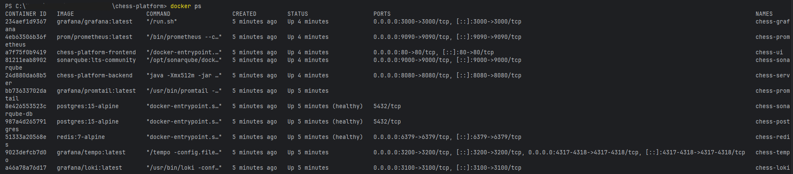
  

  

    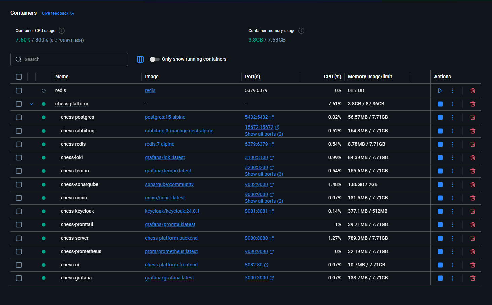
  

### 🗄️ Persistence Layer & Migrations
Database schemas and index evolutions are managed declaratively using Liquibase migrations against PostgreSQL.

  
<b>📸 Preview: Database Schema & Liquibase Verification</b>

   
  

    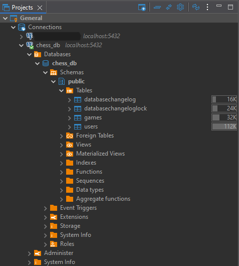
  

---

## 2. Observability & Monitoring Stack (LGTM)
> **Goal:** Implement the LGTM stack (Loki, Grafana, Tempo, Prometheus) for full-stack transparency across metrics, logs, and distributed traces.

### 📊 System Health, Telemetry & Provisioned Dashboards
System telemetry is aggregated and visualized through zero-touch Grafana provisioning configured under `deploy/monitoring/`:
* **Metrics (Prometheus):** Scrapes JVM health, garbage collection, and custom `@Observed` chess timers every 15 seconds via `/actuator/prometheus` using `deploy/monitoring/prometheus.yml`.
* **Logs (Loki & Promtail):** Promtail monitors container output and application log streams (`/app/logs/chess-backend.log`), streaming structured records with MDC `traceId` into Loki using `deploy/monitoring/promtail-config.yml` and `loki-config.yml`.
* **Distributed Tracing (Tempo & OpenTelemetry):** OpenTelemetry Java Agent auto-instruments HTTP and WebSocket threads, shipping OTLP spans to Tempo (`port 4318`) with configuration defined in `deploy/monitoring/tempo.yml`.
* **Datasources & Dashboard Provisioning:** Automated datasource wiring (`deploy/monitoring/grafana/provisioning/datasources/datasource.yml`) connects Prometheus, Loki, and Tempo for seamless log-to-trace navigation. Pre-configured JSON dashboards (`deploy/monitoring/grafana/dashboards/`) include:
    * `chess-active-games-dashboard.json`: Real-time active match sessions, player heartbeats, and room allocations.
    * `chess-metrics.json`: JVM heap allocations, CPU load, and Spring Actuator health gauges.
    * `chess-total-moves-dashboard.json`: Aggregated move frequencies, rate limiter intercepts, and WebSocket broadcast latency.
    * `grafana-chess-observability-dashboard.json`: Unified system overview correlating logs, container metrics, and error rates.
    * `trace-performance-sample.json`: Distributed trace samples analyzing database query timings and engine sub-process execution.

  
<b>📸 Preview: LGTM Observability Dashboards & Telemetry</b>

   
  

    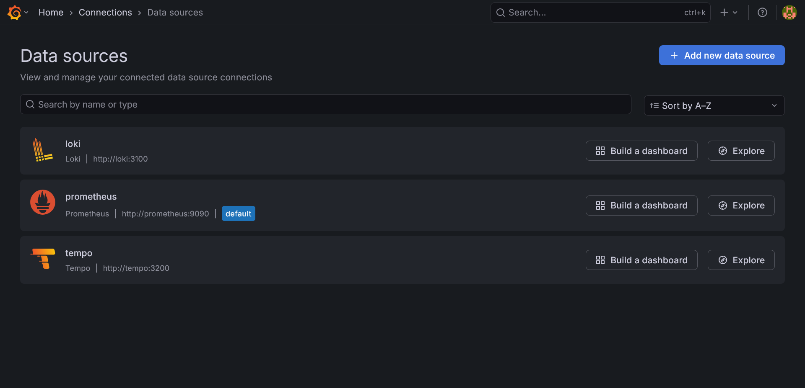
  

  

    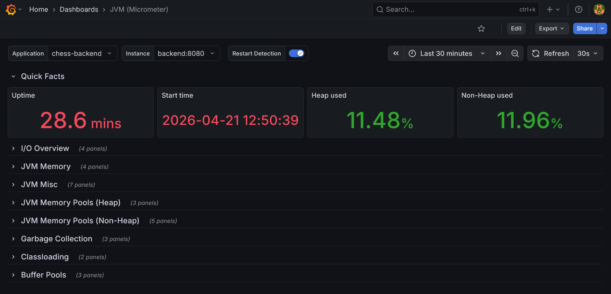
  

  

    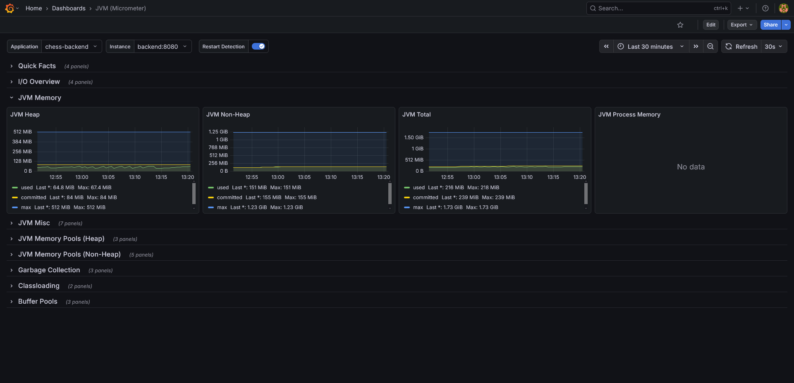
  

---

## 3. Quality Assurance, Test Automation & Coverage
> **Goal:** Maintain technical excellence and zero-regression releases through comprehensive test automation and static code validation.

### 🧪 Automated Test Suite & Quality Gate Verification
The test strategy combines isolated domain unit tests, MockMvc API validation, Testcontainers PostgreSQL persistence suites, and Playwright multi-browser automation.

| Metric / Specification | Status | Verification Reference |
| :--------------------- | :----- | :--------------------- |
| **Backend Test Suite** | **350 Passed** (0 Failures) | JUnit 5, Mockito, Testcontainers PostgreSQL |
| **Frontend Unit Suites** | **350 Passed** (54 Suites) | Vitest, React Testing Library, jsdom |
| **End-to-End Suite** | **108 Passed** (10 Suites) | Playwright (Chromium, Firefox, WebKit) |
| **Quality Gate Status** | **PASSED** (Rating A) | SonarQube Clean Code Benchmark |
| **Code Coverage** | **81.9%** (BE) / **85.5%** (FE) | JaCoCo & Vitest V8 Coverage Matrix |
| **Technical Debt** | **0 Code Smells, 0 Bugs** | Static Analysis Rules & Sealed Types |

  
<b>📸 Preview: SonarQube Quality Gates & Test Execution Proofs</b>

   
  

    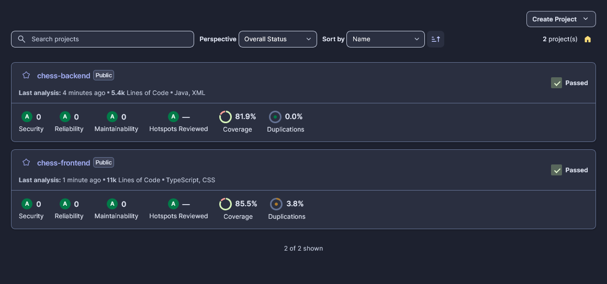
  

---

## 4. Cloud Deployment & Production Infrastructure
> **Goal:** Deploy the backend application to an Oracle Cloud Infrastructure (OCI) ARM instance, secure IAM authentication via Keycloak, and configure global frontend distribution.

### 🔐 Identity & Access Management (Keycloak)
* **Role-Based Access Control:** Configured realm roles (`ADMIN`, `USER`, `GUEST`) governing system permissions and endpoint security.
* **OIDC Client & Domain Origins:** Client settings configured with redirect URIs and Web Origins supporting Vercel and DuckDNS endpoints.

  
<b>📸 Preview: Keycloak Realm Roles & Client Settings</b>

   
  

    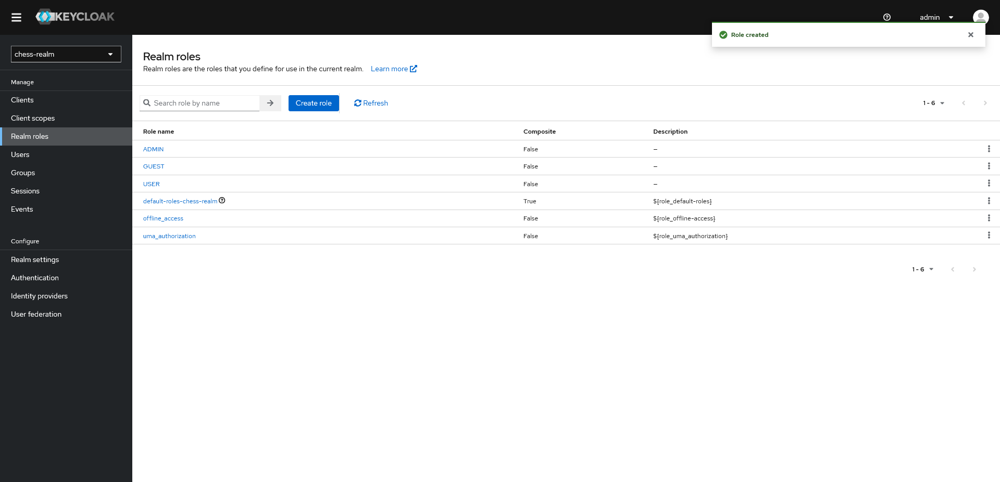
  

  

    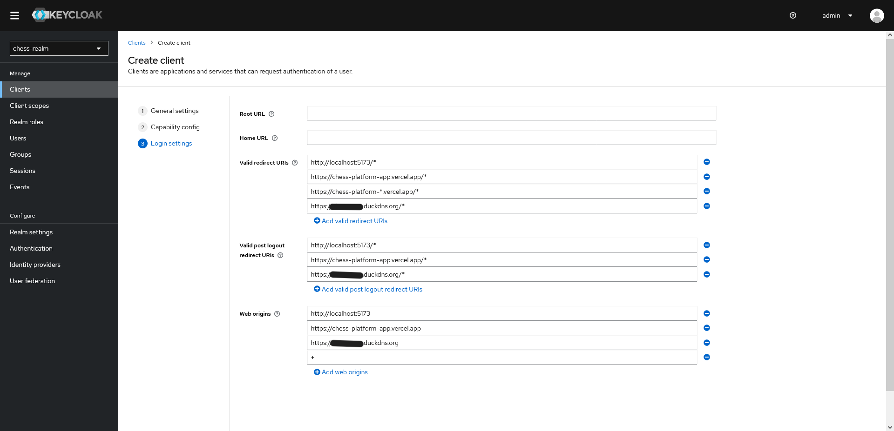
  

### ☁️ Oracle Cloud Infrastructure (OCI) Deployment
The backend ecosystem runs on an Ubuntu 24.04 ARM/Ampere instance (`chess-platform-prod`) hosted on Oracle Cloud Infrastructure, mapped via dynamic DNS (DuckDNS).

* **Cloud Artifacts:**
    * OCI Object Storage bucket configured for S3-compatible avatar and PGN artifact persistence.
    * UFW and OCI Security Lists restrict access strictly to essential ingress ports.

  
<b>📸 Preview: Cloud Host, DNS Mapping & Object Storage</b>

   
  

    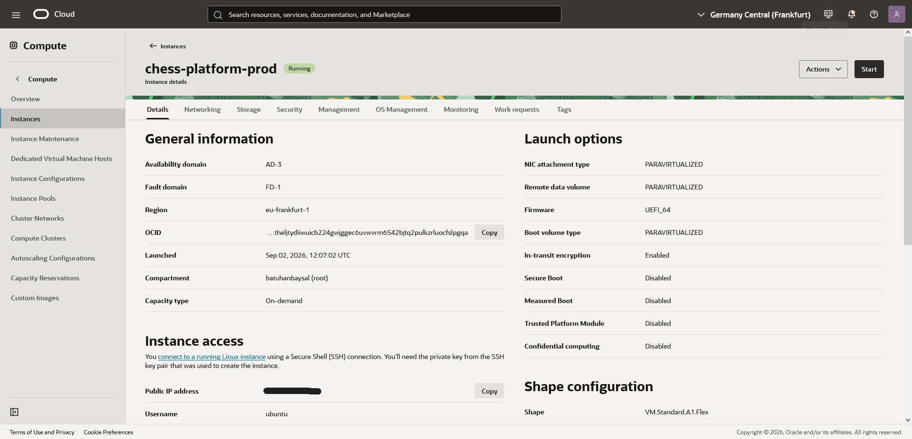
  

  

    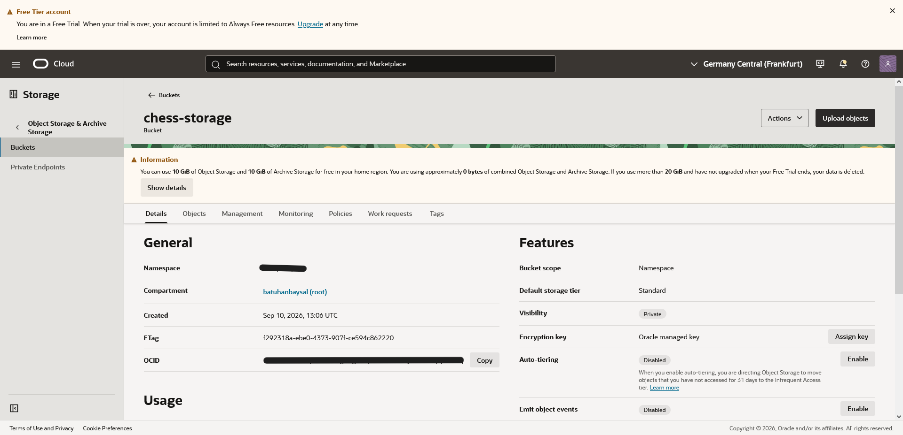
  

  

    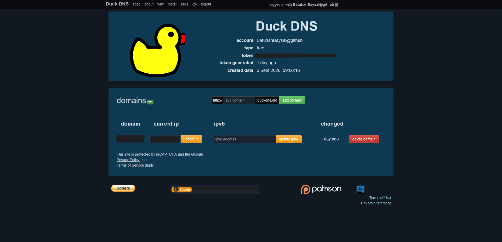
  

### 🚀 Vercel Frontend Deployment
The React 19 single-page application is hosted globally on Vercel with automatic continuous integration from the repository's production branch, pointing to the cloud backend host.
