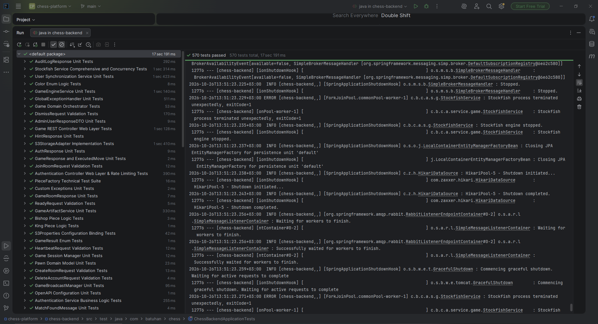
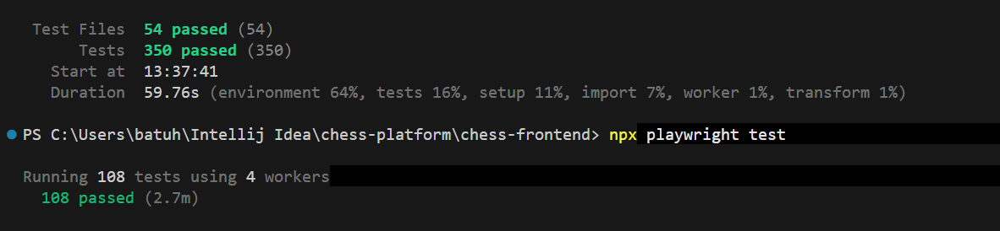
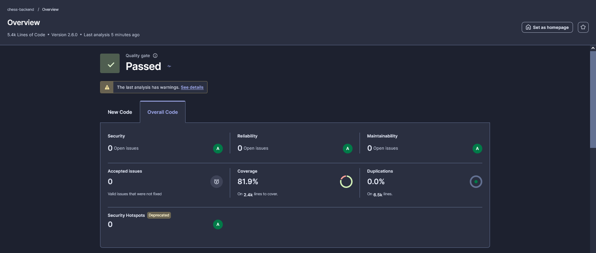
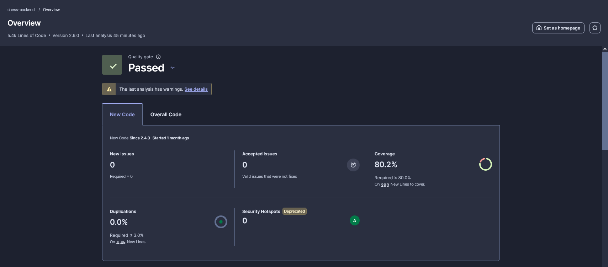
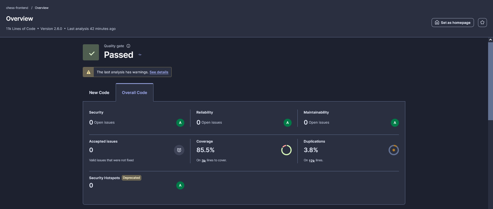
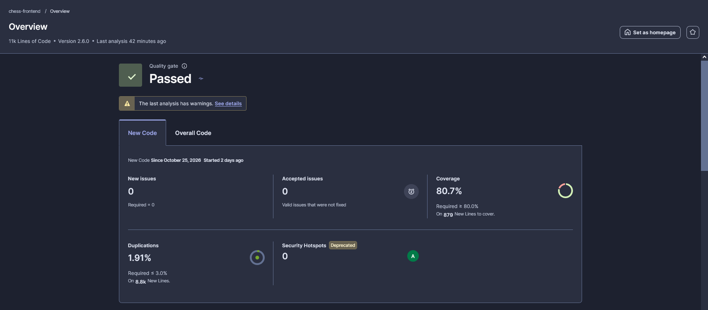

# 🧪 Testing Strategy & Quality Assurance Architecture

<p align="center">
  <!-- Quality Gate & Consolidated Metrics -->
  
  
  
  
</p>

<p align="center">
  <!-- Core Frameworks (No Versions) -->
  
  
  
  
  
  
  
  
</p>

This document defines the automated testing architecture, verification methodologies, isolation strategies, and SonarQube Quality Gate benchmarks established for the **Chess Platform** full-stack ecosystem.

---

## 🎯 Testing Philosophy & Execution Standards

The testing strategy combines domain rule verification, concurrency stress testing, real infrastructure containerization, virtual DOM component rendering, and cross-browser end-to-end automation into a cohesive quality pyramid.

* **Arrange-Act-Assert (AAA) Discipline:** Every unit, slice, and integration test suite enforces strict visual and logical separation across Arrange, Act, and Assert phases to serve as living, executable technical specifications.
* **Production Parity via Testcontainers:** Database persistence tests execute against dynamic, containerized PostgreSQL instances managed by Testcontainers. In-memory database engines (such as H2) are excluded to guarantee identical Liquibase migration execution, SQL dialect behavior, constraint triggers, and indexing semantics.
* **Deterministic Test Execution:** Test suites execute in deterministic isolation. Database fixtures are truncated between test runs, virtual clock timers are restored, and storage mock state is cleared to eliminate flaky test executions and cross-suite state leakage.

---

## 📊 Quality Gates & Test Verification Matrix

Both backend and frontend services strictly adhere to **Clean Code** standards, continuously monitored and validated through SonarQube:

| Metric / Specification | `chess-backend` (Spring Boot 3) | `chess-frontend` (React 19 & Vite) | Quality Gate Threshold | Status |
| :--------------------- | :------------------------------ | :--------------------------------- | :--------------------- | :----- |
| **Unit & Integration Tests** | **570 Tests Passed** (0 Failures, 0 Errors) | **350 Tests Passed** (54 Test Suites) | 100% Pass Rate | ✅ Passed |
| **End-to-End (E2E) Tests** | — | **108 Tests Passed** (10 Test Suites) | 100% Pass Rate | ✅ Passed |
| **Quality Gate Status** | **PASSED** | **PASSED** | Mandatory Gate | ✅ Passed |
| **New Code Coverage** | **80.2%** (290 lines to cover) | **80.7%** (879 lines to cover) | $\ge$ 80.0% | ✅ Passed |
| **Overall Coverage** | **81.9%** (2.4k lines to cover) | **85.5%** (3k lines to cover) | $\ge$ 80.0% | ✅ Passed |
| **Reliability (Bugs)** | **0 Open Issues** (Rating A) | **0 Open Issues** (Rating A) | Rating A | ✅ Passed |
| **Security (Vulnerabilities)** | **0 Open Issues** (Rating A) | **0 Open Issues** (Rating A) | Rating A | ✅ Passed |
| **Security Hotspots** | **0 Unreviewed** (Rating A) | **0 Unreviewed** (Rating A) | Rating A | ✅ Passed |
| **Maintainability (Technical Debt)** | **0 Code Smells** (Rating A) | **0 Code Smells** (Rating A) | Rating A | ✅ Passed |
| **Duplications** | **0.0%** (6.5k lines analyzed) | **1.91%** (New Code) / 3.8% (Overall) | $\le$ 3.0% (New Code) | ✅ Passed |

---

## 🧩 Architectural Breakdown by Layer

### 1. ♟️ Chess Engine & Domain Integrity (JUnit 5 & AssertJ)
The domain test suite validates complete compliance with official FIDE rules, board boundary safety, and thread safety without external framework overhead:
* **Piece Geometry & Vector Calculations:** Validates linear, diagonal, and knight L-hop movement vectors, board perimeter limits, friendly piece obstruction, and enemy capture handling across all piece types.
* **Two-Phase Move Safety:** Every candidate move is first verified for pseudo-legality, then simulated on an isolated in-memory clone of the board (`Board.copy()`). Moves that expose the King to check or violate absolute piece pins are strictly discarded.
* **Special Moves & FIDE Mechanics:** Enforces movement history prerequisites for Kingside (O-O) and Queenside (O-O-O) castling while verifying transit squares remain free of enemy attack; validates dynamic En Passant eligibility windows; and manages pawn promotion transitions to Queen, Rook, Bishop, or Knight.
* **Game Adjudication & Draw Conditions:** Detects Checkmate when in check with zero legal evasions, and Stalemate when safe but with zero legal moves. Evaluates 50-move rule half-move counters, Threefold Repetition board state histories, and Insufficient Material scenarios.
* **Immutability & Structural Safety:** Enforces valid coordinate boundaries (0–7 rank/file bounds) on position value objects and guarantees utility factories remain uninstantiable against reflection attacks.

### 2. ⚙️ Application Services, Concurrency & Messaging (Spring Boot & Testcontainers)
Orchestrates match lifecycles, sub-process bridges, distributed locking mechanisms, and asynchronous event streams:
* **Self-Healing Engine Sub-Processes (IPC):** Tests the Stockfish CLI bridge under unexpected process terminations, verifying that the service detects process death and transparently spawns a fresh runtime instance on the next move request.
* **High-Throughput Concurrency:** Executes multi-threaded stress tests across concurrent worker threads to confirm non-blocking command pipelines, deadlock-free locking, and evaluation caching thresholds.
* **Distributed Locking (Redisson RLock):** Validates mutual exclusion across move submissions and room joins, ensuring race conditions are averted and locks are safely released during error flows.
* **Millisecond Game Clocks & Watchdogs:** Decrements turn-based chess timers, awards timeout forfeits when a clock expires, cancels scheduled tasks on match completion, and flags inactive sessions when heartbeat thresholds are breached.
* **Event-Driven Messaging (RabbitMQ):** Verifies that match completion events publish typed analysis payloads to exchanges and that background workers asynchronously consume messages to run CPU-intensive evaluations without stalling the web tier.
* **Broadcast Rate Limiting:** Enforces traffic throttling across real-time sockets to batch rapid updates and prevent client-side UI saturation.
* **Infrastructure Dependency Note:** Full local execution of the backend integration test suites requires running PostgreSQL and Redis Docker containers to support live context integration tests; otherwise, context-dependent suites will fail due to connection timeouts.

### 3. 🗄️ Database Persistence & Query Performance (Data JPA)
Validates relational mapping integrity and query optimization against real PostgreSQL containers:
* **N+1 Query Elimination:** Ensures that loading match histories eagerly fetches player associations via entity graphs in single join queries without triggering secondary selects.
* **Index-Driven Leaderboards & Filters:** Verifies that leaderboard lookups execute against B-Tree rating indexes and that composite queries handle case-insensitive filtering with pagination.

### 4. 🔐 Web API, Security & Rate Limiting
Verifies HTTP contracts, OAuth2 resource server validation, and boundary exception mappings:
* **HTTP Status Code Contracts:** Asserts standard responses across endpoints, including 200/204 for successful requests, 400 for rule violations, 401/403 for unauthorized or forbidden calls, and 409 for unique resource collisions.
* **Transitive Role Hierarchy (RBAC):** Tests Keycloak JWT claim translation to confirm that Admin roles inherit User and Guest permissions, while unauthenticated or insufficient privileges are strictly denied.
* **DDoS & Brute-Force Rate Limiting:** Verifies that sensitive registration, match creation, and authentication routes trigger 429 Too Many Requests when request limits are exceeded.
* **Real-Time STOMP Handshakes:** Confirms that match sessions broadcast board states only after mutual player confirmation, and that invalid move commands route private error frames back to the caller.
* **Input Validation & Global Error Schemas:** Validates Bean Validation annotations across input records, ensuring field constraints map into unified JSON error representations.

### 5. 🖥️ Frontend Components, Custom Hooks & Reactive UI (Vitest & RTL)
Exercises UI components, view models, and browser API integrations inside an isolated virtual DOM using Vitest across 54 test suites:
* **Board Mechanics & Drag-and-Drop:** Validates 64-square grid setups, drag activations, legal target highlights, check alerts, and promotion dialogs.
* **Hardware Web Audio API Synthesis:** Asserts that sound effects (moves, captures, checks, win/loss) synthesize audio directly through browser oscillators without external media asset dependencies, tracking mute states across browser tabs.
* **Virtual Clock Progression:** Employs fake timers to verify that active turn clocks decrement by precise intervals while preserving the opposing player's time.
* **Interactive PGN Viewer:** Verifies algebraic notation parsing, bidirectional step navigation, perspective board flips, and raw PGN file exports.
* **Form UX & Safety Checks:** Tests inline regex validations, password strength meters, CapsLock indicators, and two-step forfeit flows that reset if unconfirmed within timeout windows.
* **Modal Accessibility & Scroll Governance:** Confirms that opening overlays locks document scrolling, that pressing Escape dismisses modals cleanly, and that avatar uploads reject non-compliant files before dispatch.

### 6. 🌐 End-to-End Multi-Browser Automation (Playwright E2E)
Executes end-to-end test scenarios across Chromium, Firefox, and WebKit (Safari engine) across 10 dedicated test suites:
* **Onboarding & Guest Paths:** Drives registration forms, success transitions, username auto-filling on sign-in, and one-click anonymous guest sessions.
* **Routing Security & Role Guards:** Verifies that guests and standard users navigating to administrative URLs are redirected, confirming administrative entry points remain hidden from unauthorized views.
* **Live Gameplay Interactions:** Automates mouse-driven drag-and-drop piece movement across board coordinates, testing match surrenders and safe menu navigation without session loss.
* **Responsive Layout & Network Resilience:** Validates mobile viewports (down to 390px) to ensure zero horizontal scroll overflow, and simulates offline/online network toggles to prove interface recovery.

---

## 📸 Quality Gate & Execution Evidence Gallery

All verification artifacts are maintained within `docs/assets/screenshots/04-testing/`. Click on each section below to inspect the corresponding execution proof:

<details open>
<summary><strong>1. 🖥️ Test Execution Terminals (IntelliJ IDEA & VS Code)</strong></summary>

<br>

#### 1. Backend Test Runner (IntelliJ IDEA)
IntelliJ IDEA and Maven Surefire execution output confirming 570 passing tests across controllers, domain rules, and Testcontainers integration suites:
<p align="center">
  
</p>

#### 2. Frontend Unit & E2E Test Runners (VS Code)
VS Code terminal output confirming 350 passing Vitest tests across 54 test suites, alongside 108 passing Playwright E2E tests across 10 suites:
<p align="center">
  
</p>

</details>

<details>
<summary><strong>2. ☕ SonarQube Backend Verification (<code>chess-backend</code>)</strong></summary>

<br>

#### 3. Backend Overall Code Analysis
Overall Code dashboard confirming **81.9% JaCoCo coverage**, **0.0% duplications**, and **Rating A** across Security, Reliability, and Maintainability:
<p align="center">
  
</p>

#### 4. Backend New Code Analysis
New Code dashboard confirming **80.2% coverage** on newly introduced code blocks, passing the quality gate baseline:
<p align="center">
  
</p>

</details>

<details>
<summary><strong>3. ⚛️ SonarQube Frontend Verification (<code>chess-frontend</code>)</strong></summary>

<br>

#### 5. Frontend Overall Code Analysis
Overall Code dashboard confirming **85.5% V8 coverage**, **0 open issues**, and **Rating A** across all code health metrics:
<p align="center">
  
</p>

#### 6. Frontend New Code Analysis
New Code dashboard confirming **80.7% coverage** on 879 new lines to cover, with **1.91% duplications**, achieving an automated Passed Quality Gate:
<p align="center">
  
</p>

</details>

<details>
<summary><strong>4. 🌐 Consolidated Projects Overview</strong></summary>

<br>

#### 7. Global Projects Dashboard
SonarQube Projects view confirming both `chess-backend` and `chess-frontend` modules simultaneously passing their Quality Gates:
<p align="center">
  
</p>

</details>

---

## 🛠️ Local Test Execution Commands

### 1. ☕ Backend Test & Analysis Execution

```bash
# Navigate to the backend service
cd chess-backend

# Execute unit and domain test suites
./mvnw clean test

# Execute integration tests and generate JaCoCo coverage reports
./mvnw clean verify

# Run verify phase and trigger SonarQube static code analysis
.\mvnw clean verify sonar:sonar "-Dsonar.projectKey=chess-platform" "-Dsonar.host.url=http://localhost:9002" "-Dsonar.token=YOUR_SONAR_TOKEN"
```

---

### 2. ⚛️ Frontend Test & Analysis Execution

```bash
# Navigate to the frontend workspace
cd chess-frontend

# Execute all Vitest component and hook suites
npm run test

# Run Vitest with V8 coverage matrix generation and disabled cache
npx vitest run --coverage --no-cache

# Run all 108 multi-browser Playwright E2E scenarios headless
npx playwright test

# Launch the interactive Playwright UI runner
npx playwright test --ui

# Upload frontend coverage report and execute SonarQube scanner
npx sonarqube-scanner "-Dsonar.projectKey=chess-frontend" "-Dsonar.projectName=chess-frontend" "-Dsonar.host.url=http://localhost:9002" "-Dsonar.token=YOUR_SONAR_TOKEN" "-Dsonar.sources=src" "-Dsonar.tests=src" "-Dsonar.test.inclusions=src/test/**/*.ts,src/test/**/*.tsx,**/*.test.ts,**/*.test.tsx,**/*.spec.ts,**/*.spec.tsx" "-Dsonar.exclusions=src/test/**,e2e/**,node_modules/**,dist/**,coverage/**" "-Dsonar.javascript.lcov.reportPaths=coverage/lcov.info"
```
